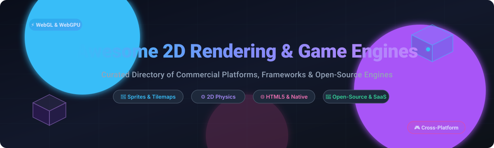

# Awesome-2D-Rendering-Game-Engines 🎮

  

  
  
  
  
  
  

---

## 🌟 Top 2D Rendering & Game Engines Ecosystem

> **A curated showcase of commercial SaaS platforms, game frameworks, and open-source game engines for 2D game development, HTML5/WebGL rendering, cross-platform compilation, sprite pipelines, and tilemap systems.**

Whether you are an indie game developer, graphics programmer, educator, or enterprise studio searching for the fastest 2D WebGL renderer, a lightweight Lua game engine, or an event-sheet visual editor, this directory categorizes the best tools available in 2026.

---

## 📑 Table of Contents

- [📊 Sector Overview & Market Dynamics](#-sector-overview--market-dynamics)
- [☁️ SaaS / Hosted Commercial Platforms](#️-saas--hosted-commercial-platforms)
- [💻 Open-Source GitHub Projects](#-open-source-github-projects)
- [🛠️ Architecture & Engine Selection Guide](#️-architecture--engine-selection-guide)
- [🤝 How to Contribute](#-how-to-contribute)
- [💖 Support & Sponsorship](#-support--sponsorship)
- [📈 Star History](#-star-history)
- [📜 Disclaimer](#-disclaimer)

---

## 📊 Sector Overview & Market Dynamics

The global game engine and real-time development software market is estimated at approximately **$3.6B to $4.4B** (scaling past **$38B+** when factoring broader simulation and enterprise visual tech). The market structure exhibits a dual dynamic: it is **heavily concentrated at the top**—dominated by an oligopoly (Unity and Epic Games) capturing massive industry revenue and game volume—while remaining **moderately fragmented across the mid and lower tiers**, where a vibrant ecosystem of specialized 2D tools, web/HTML5 runtimes, and community-driven open-source alternatives thrive.

---

## ☁️ SaaS / Hosted Commercial Platforms

| Platform | Valuation / Company Size | Pricing | Free Tier Limits | Description |
| :--- | :--- | :--- | :--- | :--- |
| **[Unity (2D features)](https://unity.com/)** | ~$19.19B Market Cap (NYSE: U) / ~$2.03B Annual Revenue | Free (Personal); Paid tiers start at **$2,100/seat/year** ($210/seat/month) for Unity Pro | Free for individuals and small studios with **< $200,000 USD** trailing 12-month revenue or funding; full engine functionality included | Leading multi-platform engine with a mature 2D toolset (sprites, tilemaps, 2D physics, animation) used for both 2D and hybrid games. |
| **[RPG Maker (Gotcha Gotcha Games / Kadokawa)](https://www.rpgmakerweb.com/)** | ~$1.8B Parent Market Cap (Kadokawa Corp / TYO: 9468; ~$190M Gaming Segment Revenue) | One-time license from **$79.99** (RPG Maker MZ) | **30-day free trial** with full feature and editor access; project saving/editing locks after 30 days and commercial deployment is prohibited during trial | Specialized series of tools for creating 2D role-playing games with map editors, event systems, and character databases—popular for story-driven titles. |
| **[GameMaker (Opera Gaming)](https://gamemaker.io/)** | ~$1.6B Parent Market Cap (Opera Ltd / NASDAQ: OPRA; acquired for $10M) | Free (Non-Commercial); Commercial Professional license starts at **$99.99 one-time** | **Free forever for non-commercial use**; exports to Desktop, Mobile, Web, and GX.games without watermarks, but selling/monetizing games is prohibited without a commercial license | Long-standing 2D game engine with its own language (GML), strong 2D tooling, and export options for multiple platforms—widely used by indie developers. |
| **[PlayCanvas (Snap Inc.)](https://playcanvas.com/)** | ~$15B Parent Market Cap (Snap Inc. / NYSE: SNAP; acquired for ~$5M) | Free tier available; Personal plan starts at **$15/user/month** | **Free forever plan** includes **1 GB storage** and unlimited public projects/collaborators; private projects and downloading code for self-hosting require a paid plan | Web-first 3D/2D engine and collaborative online editor with strong WebGL performance; the engine core is open-source while the hosted editor and services are commercial. |
| **[Cocos Creator](https://www.cocos.com/en/creator)** | $72M Acquisition Valuation (Acquired by SUD; $130M+ total funding raised) | Free core engine; Enterprise support plans require custom quotes | **Free forever with 100% full engine features**, unlimited exports, and 0% royalties; enterprise pricing applies strictly to VIP support contracts, custom modules, and marketplace assets | Component-based game engine (2D & 3D) popular in Asia and globally, with visual editor, JavaScript/TypeScript workflow, and multi-platform publishing. |
| **[Phaser Editor / Phaser Studio](https://phasereditor2d.com/)** | $45M Series B Venture Funding (Phaser Studio Inc.) | Free mode available; Subscriptions start at **$12/month** (or non-renewing fixed licenses from 1 month) | **Free forever mode** limited to a maximum project size of **200 files**; a **30-day free trial** of the full premium plan is also offered | Visual editors and commercial services built on top of the open-source Phaser framework. |
| **[Defold (Cloud & Corporate Support)](https://defold.com/)** | Non-Profit Foundation (~$1M+ endowment / King spin-off / corporate sponsorships) | Free core engine; Bronze Corporate Partner tier starts at **€500/month** (€6,000/year) | **Free forever with no revenue or feature limits**; 0% royalties and free cloud-build servers; paid tiers are corporate sponsorships providing dedicated dev hours | Cross-platform lightweight 2D engine offering official cloud build services, corporate partnership tiers, and commercial support agreements. |
| **[Construct 3 (Scirra Ltd)](https://www.construct.net/)** | ~$5M - $10M Estimated Valuation (~$2M - $4M Est. ARR, bootstrapped UK entity) | Individual subscription starts at **$129.99/year** | **Free forever plan** capped at **50 events** (verified account, or 25 for guests), **2 layers**, 2 special effects, and HTML5 web-only exports with commercial monetization restricted | Browser-based, event-sheet driven 2D game engine popular for rapid development, education, and publishing to web, desktop, and mobile without traditional coding. |
| **[Stencyl](https://www.stencyl.com/)** | Bootstrapped Indie Entity (<$2M Estimated Annual Revenue) | Free Starter Edition; Indie subscription starts at **$99/year** | **Free forever Starter plan** limited to **Web/HTML5 exports only** with a mandatory Stencyl splash screen/watermark; desktop/mobile publishing is locked | Visual, block-based 2D game creator aimed at beginners and rapid prototyping, with export to desktop and mobile. |

---

## 💻 Open-Source GitHub Projects

Sorted descending by GitHub stars count:

1. **[Godot Engine](https://github.com/godotengine/godot)**   
   🚀 *C++ / GDScript* • Fully featured, multi-platform open-source engine with an exceptional dedicated 2D node hierarchy, custom 2D transform pipeline, tilemap layers, Y-sort, 2D lighting, bone animation, and zero royalties.

2. **[Bevy](https://github.com/bevyengine/bevy)**   
   🦀 *Rust* • A refreshingly simple data-driven game engine built in Rust with an ergonomic Entity Component System (ECS), high-performance 2D sprite renderer, hot-reloading, and modern rendering abstractions.

3. **[PixiJS](https://github.com/pixijs/pixijs)**   
   ⚡ *JavaScript / TypeScript* • The HTML5 creation engine—an ultra-fast 2D WebGL/WebGPU rendering pipeline used as the foundational visual powerhouse for high-traffic browser games, interactive web apps, and frameworks like Phaser.

4. **[Phaser](https://github.com/phaserjs/phaser)**   
   🕹️ *JavaScript / TypeScript* • Battle-tested desktop and mobile HTML5 2D game framework featuring arcade & matter physics engines, sprite animations, camera systems, sound managers, and tilemap parsers.

5. **[Raylib](https://github.com/raysan5/raylib)**   
   🎯 *C* • Highly accessible, lightweight C library for learning game programming and creating 2D graphics without heavy abstractions, featuring immediate/retained-mode 2D rendering and bindings in 50+ languages.

6. **[LibGDX](https://github.com/libgdx/libgdx)**   
   ☕ *Java / Kotlin* • Battle-hardened Java game development framework providing unified cross-platform APIs for Windows, macOS, Linux, Android, iOS, and WebAssembly, powering commercial hits like *Slay the Spire*.

7. **[p5.js](https://github.com/processing/p5.js)**   
   🎨 *JavaScript* • Complete creative coding and 2D canvas library that makes interactive graphics, generative art, and 2D game experiments approachable for artists, educators, and indie developers.

8. **[OpenRA](https://github.com/OpenRA/OpenRA)**   
   ⚔️ *C#* • Open-source real-time strategy (RTS) game engine supporting early 2D Westwood classics (Command & Conquer, Red Alert) with modern 2D isometric rendering and multiplayer networking.

9. **[SDL (Simple DirectMedia Layer)](https://github.com/libsdl-org/SDL)**   
   🔧 *C* • Cross-platform development library designed to provide low-level access to 2D hardware accelerated graphics, audio, keyboard, mouse, and joystick across virtually every platform.

10. **[MonoGame](https://github.com/MonoGame/MonoGame)**   
    🎮 *C# / .NET* • Free open-source reimplementation of Microsoft XNA powering critically acclaimed 2D indie titles like *Celeste*, *Stardew Valley*, and *Bastion* with high-performance C# code on PC, mobile, and consoles.

11. **[Ebitengine](https://github.com/hajimehoshi/ebiten)**   
    🐹 *Go* • An open-source 2D game library for Go with an exceptionally clean and simple API (`DrawImage`), automatic texture atlas generation, and WebAssembly/desktop/mobile compilation.

12. **[SFML (Simple and Fast Multimedia Library)](https://github.com/SFML/SFML)**   
    ⚡ *C++* • Simple, fast, and portable multimedia library for 2D graphics rendering, windowing, audio, and networking, serving as the go-to foundational library for modern 2D C++ developers.

13. **[Pygame-ce (Community Edition)](https://github.com/pygame-community/pygame-ce)**   
    🐍 *Python / C* • Fast, modern, community-maintained fork of Pygame offering optimized 2D sprite handling, software/hardware rendering, surface operations, and audio control in Python.

14. **[Love2D](https://github.com/love2d/love)**   
    💖 *Lua / C++* • Elegant and minimal 2D framework for Lua, adored for rapid prototyping, game jams, clean declarative graphics calls, and direct control over frame loops.

15. **[melonJS](https://github.com/melonjs/melonJS)**   
    🍉 *JavaScript / TypeScript* • Standalone, lightweight 2D gaming framework with built-in Tiled map support, physics, and WebGL rendering with canvas fallback.

16. **[Defold](https://github.com/defold/defold)**   
    🛡️ *C++ / Lua* • Turnkey 2D-focused game engine with a tiny binary footprint, blazing-fast runtime, zero memory leaks, and built-in editor supporting web, desktop, and mobile export.

17. **[Heaps.io](https://github.com/HeapsIO/heaps)**   
    🔥 *Haxe* • Mature graphics engine created by the author of Haxe, powering commercially successful titles such as *Dead Cells* and *Northgard* with stellar 2D rendering performance.

18. **[Excalibur.js](https://github.com/excaliburjs/Excalibur)**   
    ⚔️ *TypeScript* • Modern, batteries-included 2D TypeScript game engine with physics, sprite sheets, particle systems, pathfinding, and rich developer documentation.

19. **[HaxeFlixel](https://github.com/HaxeFlixel/flixel)**   
    🔷 *Haxe / OpenFL* • Cross-platform 2D engine rooted in the classic Flixel API, bringing nostalgic 2D arcade physics, state management, and sprite animations to desktop, mobile, and web.

---

## 🛠️ Architecture & Engine Selection Guide

When deciding between an open-source framework or a hosted SaaS platform, consider the following technical criteria:

* **Pure High-Performance 2D Web Graphics:** Choose **[PixiJS](https://github.com/pixijs/pixijs)** or **[Phaser](https://github.com/phaserjs/phaser)** for web-first distribution with WebGL/WebGPU acceleration.
* **Full-Featured 2D Editor with Node / Scene Tree:** Choose **[Godot Engine](https://github.com/godotengine/godot)** for a free, open-source workflow or **[Construct 3](https://www.construct.net/)** / **[GameMaker](https://gamemaker.io/)** for visual rapid prototyping.
* **Code-Only / Language Specific Control:**
  * **Rust:** **[Bevy](https://github.com/bevyengine/bevy)** (Modern ECS architecture)
  * **C# / .NET:** **[MonoGame](https://github.com/MonoGame/MonoGame)** (Indie console powerhouse)
  * **C / C++:** **[Raylib](https://github.com/raysan5/raylib)** or **[SFML](https://github.com/SFML/SFML)** (Clean APIs, low overhead)
  * **Lua:** **[Love2D](https://github.com/love2d/love)** or **[Defold](https://github.com/defold/defold)** (Fast iteration, small binaries)
  * **Java / Kotlin:** **[LibGDX](https://github.com/libgdx/libgdx)** (Proven multi-platform stability)
  * **Go:** **[Ebitengine](https://github.com/hajimehoshi/ebiten)** (Dead-simple 2D sprite calls)
  * **Python:** **[Pygame-ce](https://github.com/pygame-community/pygame-ce)** (Great for beginners and education)

---

## 🤝 How to Contribute

Contributions are warmly welcome! Help keep this curated list fresh and relevant:

1. 🍴 **Fork the repository** on GitHub.
2. 🌿 **Create a new branch** (`git checkout -b feature/add-new-engine`).
3. 📝 **Add your entry** following the existing format:
   - Platform / Repository name with official link.
   - For open-source repos: include star badge link, primary language, and 1–2 sentence technical description.
   - For SaaS products: include pricing, free tier limits, and company size.
4. 🚀 **Commit your changes** and push to your fork.
5. 📬 **Open a Pull Request** with a brief summary of the engine and its ecosystem relevance.

---

## 💖 Support & Sponsorship

If you find this list helpful for your game development journey or research, consider supporting the project! Your encouragement helps keep this ecosystem directory up to date:

* ⭐ **Star this repository** to help others discover it.
* 🍴 **Fork and share** with fellow developers and community discords.
* ☕ **Buy a coffee & sponsor**: Support continued maintenance via the [GitHub Sponsor Dashboard](https://github.com/sponsors/ishandutta2007).

Thank you to all contributors and sponsors for keeping game creation open and accessible! 🎮✨

---

## 📈 Star History

---

## 📜 Disclaimer

- This is an **independently curated community list** provided for educational and research purposes.
- Mentions do not imply commercial endorsement. Software licensing terms, prices, and features are subject to change by their respective copyright holders.
- Always consult official documentation and license agreements before shipping commercial video games.

---

  <b>Crafted with ❤️ for game developers, indie creators, educators, and graphics engineers worldwide.</b>

